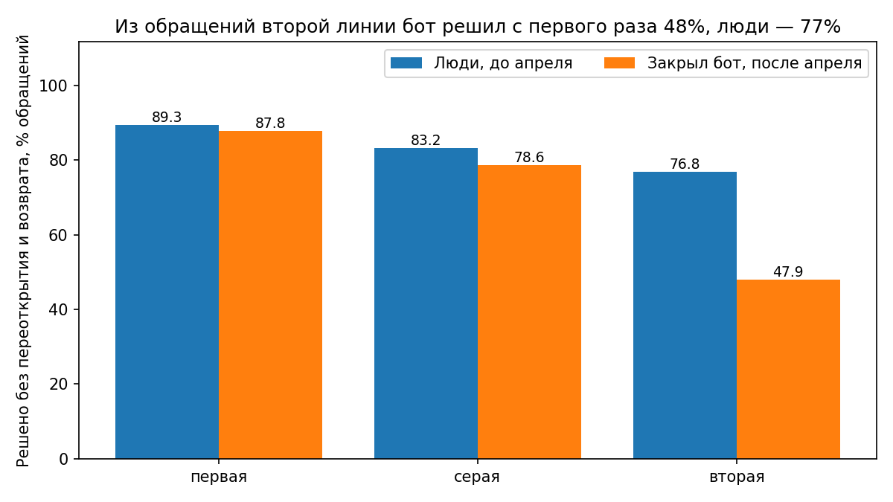

# Support bot analysis

Разбор выгрузки тикетов службы поддержки за январь–июнь 2025. С 1 апреля в письменных каналах (чат, почта, форма) отвечает бот. Я хотела понять, можно ли отдать ему не только простые вопросы, но и юридические, жалобы и возвраты денег.

Данные учебные. Все расчёты на SQL (SQLite), Python нужен, чтобы собрать базу, написать две недостающие функции и нарисовать один график.

## К чему я пришла

Бот справляется с первой линией и плохо справляется со второй. Из обращений второй линии, которые бот закрыл сам, без переоткрытия и повторного обращения в течение 7 дней решено 47,9%. У людей до апреля на тех же темах было 76,8%.



Несколько вещей, которые меняют картину:

Если считать «решено» только по флагу переоткрытия, бот на второй линии выглядит почти как люди (80,6% против 84,0%). Но клиент, которому не помогли, часто не переоткрывает старое обращение, а пишет новое по той же теме. Поэтому я считаю ещё и повторные обращения за 7 дней, и там разрыв становится большим.

Граница между первой и второй линией нечёткая, и от неё зависит вывод. Я выделила серую зону: темы средней сложности с высоким приоритетом, 1402 обращения (20,7%). Если отнести её ко второй линии, разрыв сжимается с 28,9 до 12,9 пункта. В самой серой зоне бот справляется почти как люди (78,6% против 83,2%), так что там его можно пробовать отдельно.

Не всё падение качества связано с ботом. По телефону, где бота нет, доля решённых тоже просела (84,5% → 82,9%), в письменных каналах сильнее (85,7% → 82,0%).

Полный текст со всеми оговорками: [analysis/report.md](analysis/report.md).

## Что с данными

Выгрузку пришлось проверять до всяких выводов. Нашлось следующее: 273 полных дубля из 7033 строк; канал «чат» записан и с большой буквы, и с маленькой; пустая тема встречается в двух видах, как пустая строка и как текст `NULL`, причём коллега, который делал чистку, исправил только первый; 2119 дат записаны как ДД.ММ.ГГГГ, из-за чего простое сравнение строк даёт неверное число обращений «после апреля»; в нумерации не хватает 187 номеров, до апреля 1,0%, после 4,2%.

Из этого же аудита два вывода, которые легко сделать зря. «Первый ответ стал быстрее в 40 раз» верно только для писем и чатов, где теперь отвечает бот, а по телефону время не изменилось. «Возвратов в конце июня стало меньше» тоже неверно: выгрузка кончается 30 июня, и у последней недели просто не успело пройти семь дней.

## Как запустить

Нужен Python 3. Для графика ещё `pip install matplotlib`. Команды запускаются из корня репозитория.

```
python3 src/run_sql.py analysis/01_data_audit.md
python3 src/run_sql.py analysis/02_segmentation.md
python3 src/run_sql.py analysis/03_bot_by_segment.md
python3 src/run_sql.py analysis/report.md "Главное число"
python3 src/staff.py
python3 src/workload.py
python3 src/chart.py
```

`run_sql.py` выполняет SQL-блоки из markdown-файла и печатает результат рядом с моим текстом, так что число в выводе легко сверить с запросом.

## Что где лежит

```
data/        tickets.csv (выгрузка), agents.csv (справочник сотрудников)
src/         db.py собирает базу, run_sql.py гоняет запросы из .md,
             sql_functions.py (MEDIAN и unicode_lower для SQLite),
             staff.py, workload.py, chart.py
analysis/    01_data_audit.md      что не так с выгрузкой
             02_segmentation.md    деление обращений на сегменты
             segments.csv          сегмент для каждой пары тема + приоритет
             03_bot_by_segment.md  бот против людей по сегментам
             report.md             итоговая записка
```

## Ограничения

Сегменты я задала сама по времени обработки до апреля (меньше 20 минут, от 20 до 40, от 40). Другая граница даст другие числа, поэтому в записке приведены оба варианта. Если вместе с ботом с апреля изменилось что-то ещё (сезон, нагрузка), в данных это не отделить, телефон помогает только отчасти. Текстов ответов бота и стоимости часа работы людей в выгрузке нет, так что оценить выгоду в деньгах нельзя.
